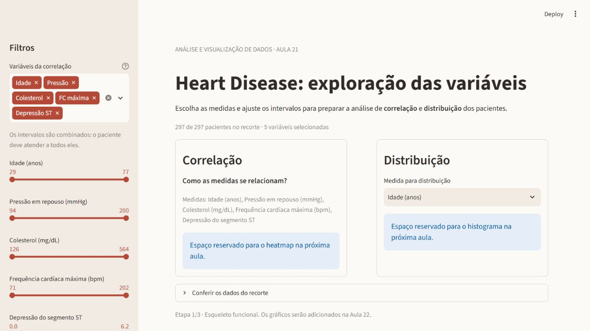

# Aula 21 · Streamlit parte 1

**Guilherme Alcoforado Rabelo · Análise e Visualização de Dados · 2026.2**

Esqueleto do primeiro dashboard, usando a EDA de Heart Disease encontrada no notebook da Aula 11. A sidebar seleciona variáveis quantitativas e seus intervalos. A área principal reserva duas colunas para correlação e distribuição. Os filtros já funcionam; heatmap e histograma entram na próxima aula, como pede o slide 21.



## Executar no Windows

Na pasta do projeto, com Python 3.11 ou superior:

```powershell
python -m venv .venv
.venv\Scripts\python.exe -m pip install -r requirements.txt
.venv\Scripts\python.exe -m streamlit run app.py
```

Abra o endereço exibido pelo terminal, normalmente `http://localhost:8501`. Não é necessário ativar o ambiente virtual. O dashboard usa os CSVs locais e não precisa de internet durante o uso.

## Arquivos da entrega

```text
app.py                         esqueleto e filtros do Dashboard 1
src/data_loader.py             leitura do tratado com cache
notebooks/eda.ipynb             notebook da Aula 11 atualizado e executado
data/raw/processed.cleveland.data  arquivo original da UCI, sem alterações
data/raw/dataset_original.csv   dataframe original: 303 linhas e 14 colunas
data/clean/dataset.csv          dataframe tratado: 297 linhas e 17 colunas
data/README.md                 origem, licença e dicionário das medidas
docs/ENTREGA.md                 explicação, demonstração e entrega
docs/layout.svg                rascunho do layout
prompts/uso_de_ia.md            declaração de uso de IA
tests/test_entrega.py           verificações dos dados e da interação
```

O modelo da professora está em [AVD-20262-pratica-streamlit](https://github.com/mfal-school/AVD-20262-pratica-streamlit). Foram mantidas as convenções `data/raw`, `data/clean`, `notebooks` e `src`. Neste projeto os dados brutos públicos também são versionados para atender à entrega de notebook **e datasets**, permitir auditoria e dispensar downloads ao executar a EDA.

## Resultado dos dados

- A base Cleveland tem 303 pacientes; `ca` tem quatro valores ausentes e `thal`, dois.
- O tratamento do notebook remove as seis linhas sem esses exames, resultando em 297 pacientes, sem imputação.
- `num` é substituída por `doenca_cardiaca`: zero corresponde a Normal; valores de 1 a 4, a Cardíaco.
- O tratado mantém `chol_log`, `sexo_label` e `faixa_etaria`, geradas na EDA. A faixa etária usa intervalos coerentes com seus rótulos: menos de 45, 45–54, 55–64 e 65 ou mais.
- Outliers quantitativos são preservados. O usuário pode retirá-los temporariamente da análise com os sliders, sem alterar os CSVs.

Somente `age`, `trestbps`, `chol`, `thalach` e `oldpeak` entram no seletor de quantitativas. Códigos numéricos de categorias, como `sex` e `cp`, não são tratados como medidas contínuas.

## Reexecutar a EDA e validar

```powershell
.venv\Scripts\python.exe -m pip install -r requirements-dev.txt
.venv\Scripts\python.exe scripts/executar_notebook.py
.venv\Scripts\python.exe -m unittest discover -s tests -v
```

Também é possível abrir `notebooks/eda.ipynb` no Jupyter ou VS Code, selecionar o Python da `.venv` e executar todas as células. Os caminhos funcionam tanto na raiz do projeto quanto em `notebooks/`. O primeiro carregamento exporta o dataframe original, e a última célula exporta o tratado.

## Entregar

A entrega do dia é um **commit com push no repositório do aluno**, contendo notebook, datasets e esqueleto do app. Veja [o guia de entrega](docs/ENTREGA.md). A publicação no Streamlit Community Cloud está prevista para a Aula 23 e não é necessária nesta etapa.

**Dataset e aprovação:** Heart Disease também é a base da demonstração em aula. O uso aqui foi confirmado pelo aluno a partir do notebook encontrado. Essa confirmação não comprova aprovação docente como dataset próprio; se ainda não houver aprovação, alinhar com a professora e informar no Classroom, conforme o slide 3.

Referências técnicas: [Streamlit](https://docs.streamlit.io/), [dataset Heart Disease](https://archive.ics.uci.edu/dataset/45/heart+disease). Declaração de IA em [prompts/uso_de_ia.md](prompts/uso_de_ia.md).
