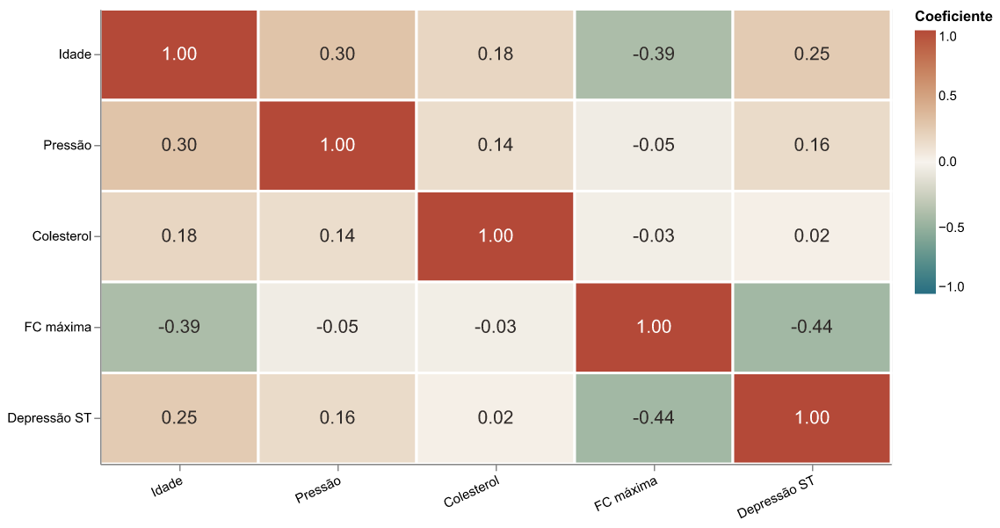

# Heart Disease · dois dashboards em Streamlit

**Guilherme Alcoforado Rabelo · Análise e Visualização de Dados · 2026.2**

Laboratório de distribuição/correlação e panorama descritivo para **coordenadores de pesquisa cardiovascular**, usando a EDA Cleveland Heart Disease da Aula 11.

<!-- APP_PUBLICADO:INICIO -->
**App publicado:** [Abrir os dois dashboards](https://avd-atividade-w5d8w43i4vfnpdt4ktapyr.streamlit.app/)

Acesso HTTP público conferido; teste dos widgets em janela anônima deve ser registrado em entregas/teste-app-publicado.md.
<!-- APP_PUBLICADO:FIM -->

[Repositório público](https://github.com/GuitGud/AVD-atividade) · [Instruções de publicação](docs/PUBLICACAO.md) · [Checklist de entrega](entregas/README.md)

## O que o aplicativo oferece

**Dashboard 1 · Laboratório:** mapa de calor com Pearson, Spearman ou Kendall; um histograma por medida quantitativa selecionada; controle do máximo de classes e separação por desfecho. Coeficientes indefinidos não são transformados em zero.

**Dashboard 2 · Panorama da pesquisa:** cinco métricas do conjunto A escolhido pelo aluno: percentual de diagnóstico positivo, percentual de angina no esforço, idade mediana, colesterol mediano e frequência cardíaca máxima mediana. Três visuais adicionais: percentual positivo por sexo registrado, composição por faixa etária e dispersão entre colesterol e FC máxima.

**Sidebar:** seletor de medidas, filtro de desfecho, sliders inclusivos e restauração. Todos os controles alimentam o mesmo recorte nos dois dashboards. Há prévia e download de um CSV com as colunas públicas selecionadas.

## Executar localmente

Recomendado: Python 3.12. Em PowerShell, na raiz do projeto:

```powershell
python -m venv .venv
.venv\Scripts\python.exe -m pip install -r requirements.txt
.venv\Scripts\python.exe -m streamlit run app.py
```

Abra o endereço indicado pelo terminal, normalmente `http://localhost:8501`. A execução do app não depende de download do dataset, de chaves de API ou de serviços externos. Não é necessário ativar a `.venv`.

## Dados e valores de conferência

- Original: **303 linhas e 14 colunas**, mantido em `data/raw/`.
- Tratado: **297 linhas e 17 colunas**, exportado pelo notebook para `data/clean/dataset.csv`.
- Seis registros removidos por ausências em `ca`/`thal`; outliers preservados.
- Diagnóstico no tratado: 160 Normal e 137 Cardíaco.
- KPIs sem filtros: 46,1% positivos; 32,7% com angina no esforço; medianas de 56 anos, 243 mg/dL e 153 bpm.
- Idade 45–60 e colesterol 200–260: **82 pacientes**.

O app aceita somente as colunas públicas necessárias e não carrega nomes, e-mails, IDs ou credenciais. O download contém apenas as medidas selecionadas e o desfecho. Essa revisão é específica dos arquivos do projeto; não substitui o teste do app após publicação.

A amostra é histórica e selecionada. Seus percentuais não representam a prevalência ou o risco da população; os painéis não fazem diagnóstico ou recomendação clínica. As definições e o espaço para justificativa individual estão em [entregas/justificativa-metricas.md](entregas/justificativa-metricas.md).

## Entregáveis

```text
app.py                              entrada dos dois dashboards
src/analytics.py                    filtros, KPIs e agrupamentos
src/charts.py                       especificações Altair
src/data_loader.py                  leitura local e esquema público
notebooks/eda.ipynb                  EDA executada e exportação dos dados
data/raw/                           fonte original e dataframe original
data/clean/dataset.csv              dataframe tratado
entregas/rascunho-dashboard-1.pdf    rascunho do laboratório
entregas/rascunho-dashboard-2.pdf    rascunho do panorama
entregas/justificativa-metricas.md   definições + preenchimento pessoal pendente
entregas/previews/                  nove gráficos reais exportados, sem captura de navegador
prompts/exemplo-dialogo-ficticio.md  diálogo inventado, identificado como fictício
prompts/EXEMPLO_FICTICIO_DECLARACAO_IA.pdf  exemplo ilustrativo sem assinatura
```

**Declaração real:** por solicitação do aluno, será elaborada por ele. O PDF fictício não a substitui. O template pede que a declaração verdadeira e assinada seja entregue como `prompts/DECLARACAO_IA.pdf`; esse arquivo permanece pendente. Também falta completar a justificativa pessoal das métricas.

**Dataset:** Heart Disease também aparece na demonstração da disciplina. O uso foi confirmado pelo aluno, mas a aprovação docente como dataset próprio deve ser conferida por ele.

## Testes e reprodutibilidade

```powershell
.venv\Scripts\python.exe -m pip install -r requirements-dev.txt
.venv\Scripts\python.exe -m unittest discover -s tests -v
.venv\Scripts\python.exe scripts/executar_notebook.py
```

Os **15 testes** cobrem fórmulas, denominadores, dados exportados, os dois painéis, os controles, recortes vazios, medida constante e amostra unitária. Veja [a validação técnica](docs/VALIDACAO.md). Eles não equivalem ao teste em janela anônima.

Para regenerar as prévias e os PDFs:

```powershell
.venv\Scripts\python.exe scripts/exportar_graficos.py
.venv\Scripts\python.exe scripts/gerar_pdfs_entrega.py
```



## Publicação e teste final

No [Streamlit Community Cloud](https://share.streamlit.io), utilize o repositório `GuitGud/AVD-atividade`, a branch `codex/aula21`, o arquivo `app.py` e Python 3.12. Não há secrets para cadastrar. [Siga as instruções completas](docs/PUBLICACAO.md).

O link público só será incluído neste README após existir e ser verificado; nenhum endereço de app fictício foi inserido. O checklist de janela anônima está em [entregas/teste-app-publicado.md](entregas/teste-app-publicado.md).

Fontes: [UCI Heart Disease](https://archive.ics.uci.edu/dataset/45/heart+disease), [modelo da disciplina](https://github.com/mfal-school/AVD-20262-pratica-streamlit), [documentação Streamlit](https://docs.streamlit.io/).
